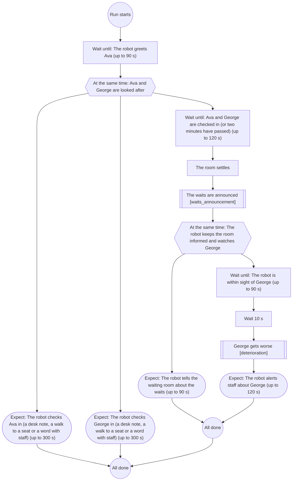
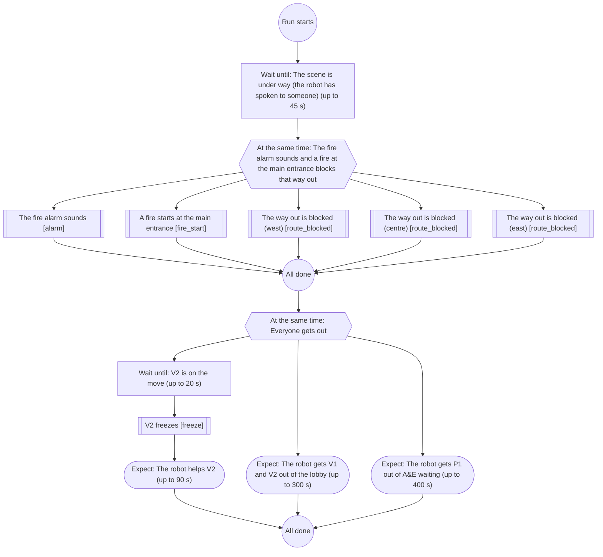
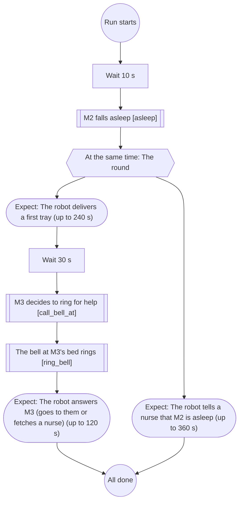
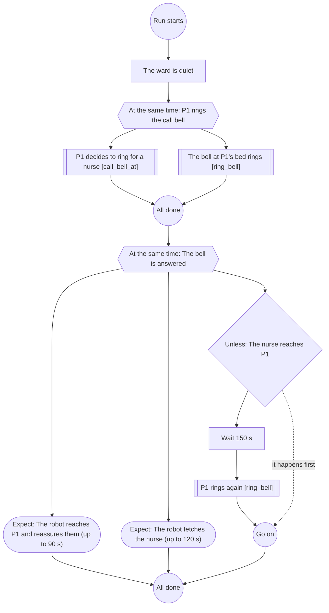
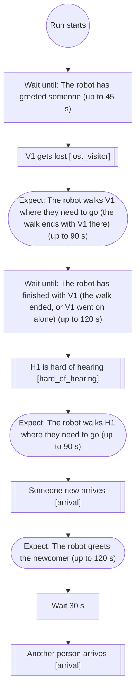
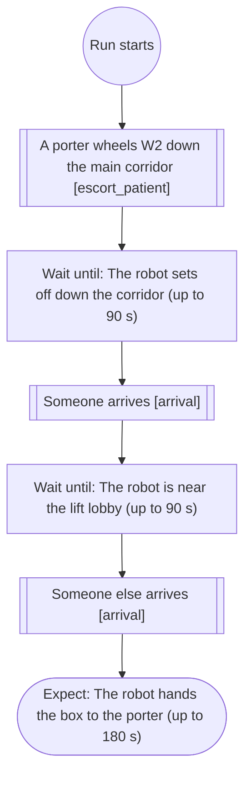
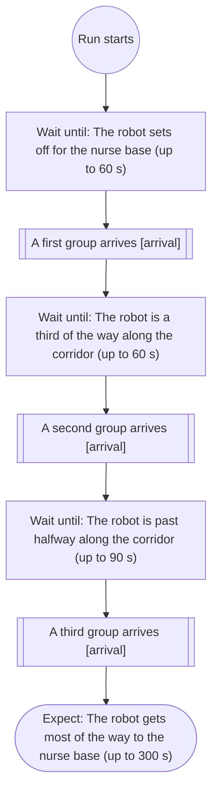
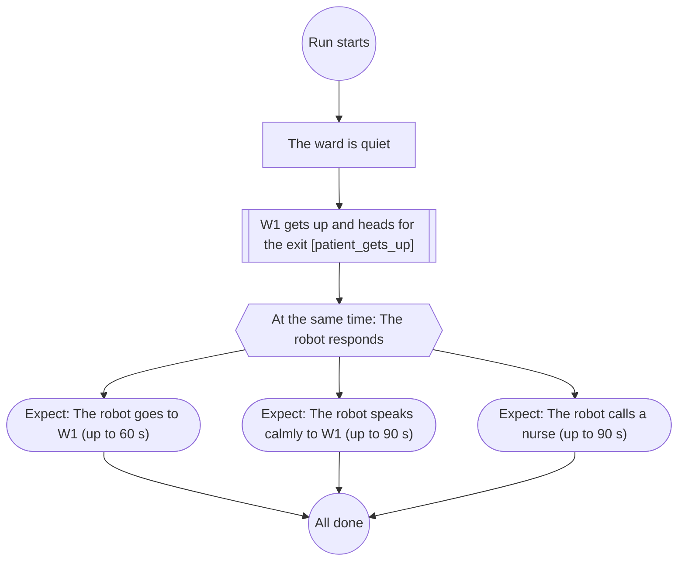
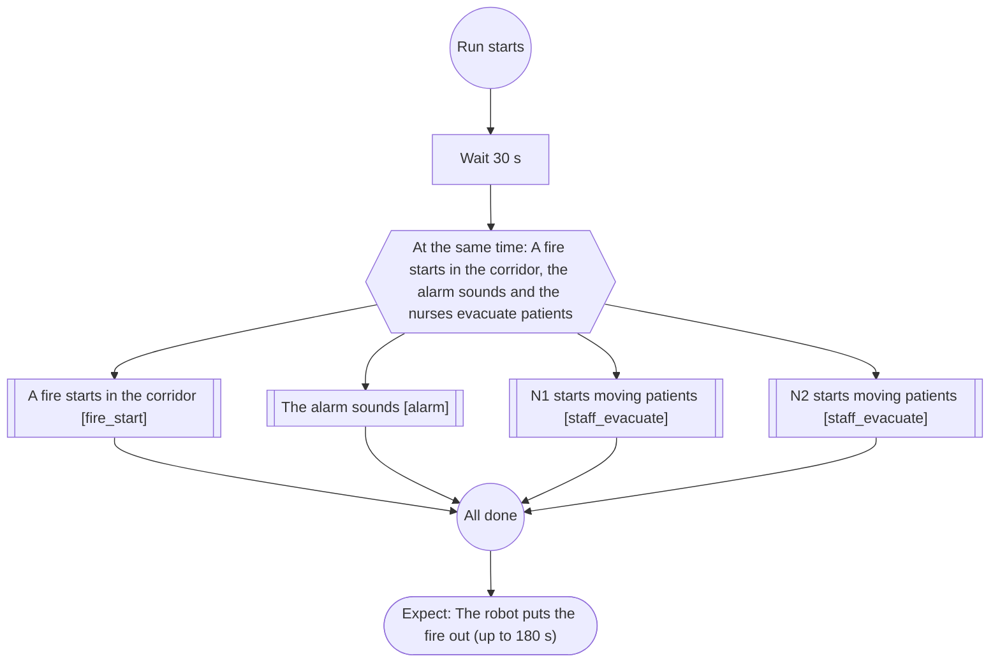

# Scenario flows

Each scenario preset has a flow: what should happen, in order. The director runs it as a py_trees behaviour tree, every 0.5 s of simulated time. A step that waits for something (the robot greets someone, a person sits down) holds the flow until it happens or until its time limit, so a scenario always moves on. An event step plays a storyboard card. An expect step is what the robot should do in reply: the run records whether it did.

The flows are YAML files in `config/presets/flows/`; the format is in `wardzero_agents/flows/spec.py`. When a user rewrites a scenario's prompt in the Studio, the flow is adapted to the new prompt by a model before the next run starts (`wardzero_agents/flows/generate.py`), checked against the scenario's people, cards and rooms, and shown under View flow. Removing a person a flow refers to drops the events aimed at them.

This file is made by `python scripts/flows_doc.py`; a test fails when it is out of date.

## A&E waiting room (`ae_waiting`)

Patients arrive and the robot checks them in and seats them. Once the room has settled the waits are announced and the robot should tell the room; then George gets worse where the robot can see him, and the robot should alert staff. A check-in note read late (the receptionist away from her desk) still counts, and does not hold the room back.

## Evacuation guide (`evacuation_guide`)

The fire alarm sounds in the lobby once the scene is under way. At the same moment a fire at the main entrance blocks that way out, and one person freezes. The robot should get everyone out the other way, including the patient in A&E waiting, and help the person who froze.

## Meal round (`meal_round`)

The robot brings lunch trays to a six-bed ward. One patient falls asleep early on; later another rings for help. The robot should deliver trays within reach, skip the sleeping patient and tell a nurse.

## Night call bell (`night_call_bell`)

On a quiet night ward a patient rings the call bell while the nurse is busy. The robot should reassure them and fetch the nurse. If no nurse has come, the patient rings again.

## Reception guide (`reception_guide`)

People come to the main reception. Once the robot is talking to people, one visitor gets lost; once the robot has finished with her, a patient who is hard of hearing needs the way to his clinic; then new people arrive. The robot should help each one in turn.

## Specimen run (`specimen_run`)

The robot carries a specimen box from the ward to the porter at the main lifts. Traffic builds as it goes - a porter wheels a patient down the main corridor, and people arrive as it reaches the corridor and the lift lobby.

## Visiting rush (`visiting_rush`)

Visiting hours start as the robot sets off for the nurse base. Groups arrive as it sets off, a third of the way and past halfway along the corridor. The robot should give way and keep a walking pace.

## Wandering patient (`wandering_patient`)

At night a confused patient gets out of bed and heads for the ward entrance. The robot should notice, stay with them calmly and call a nurse, without blocking or holding them.

## Ward fire (`ward_fire`)

A small fire starts in the ward corridor; the alarm sounds and the nurses start moving patients at once. The robot should put the fire out without getting in the way.

